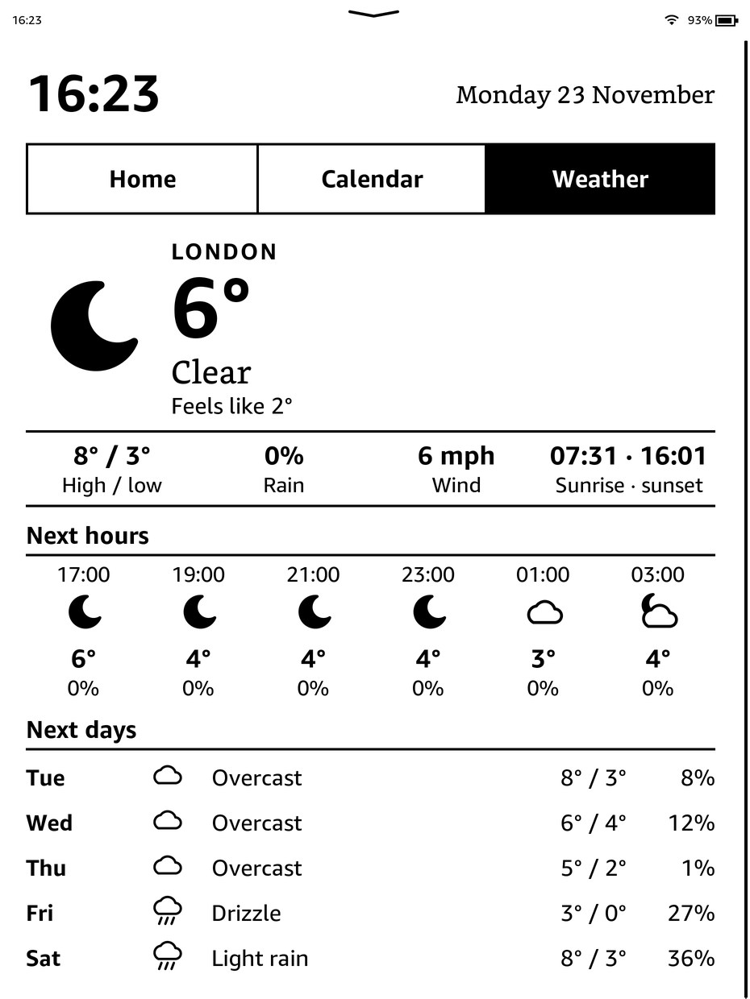

# kindle-dash

An e-ink dashboard for a jailbroken Kindle Scribe. The Mac mini serves three screens on port 8090:

- **Home**: one tile per Home Assistant `light.*` entity (tap to toggle), plus All on and All off.
- **Calendar**: the next 7 days from one or more Google Calendar secret iCal links.
- **Weather**: current conditions, the next 12 hours and the next 5 days from [Open-Meteo](https://open-meteo.com) (no API key), with an icon per condition. The location is Home Assistant's home location, rounded to 2 decimal places (about 1 km) before it is sent.

`/` opens Calendar. Calendar and Weather swap every `KINDLE_DASH_ROTATE_SECONDS`; each swap reloads the data. Home goes back to Calendar after `KINDLE_DASH_HOME_IDLE_SECONDS` without a tap.



The Kindle shows them in a Kindle web app (`dev.kindledash`) that opens full-screen at boot. Secrets stay on the Mac; the Kindle only loads the pages.

## Mac mini

| Item | Value |
|---|---|
| Entry point | `kindle-dash` → `kindle_dash.app:main`, listens on `0.0.0.0:8090` |
| Service | launchd `local.kindle-dash` (`deploy/local.kindle-dash.plist`, installed in `~/Library/LaunchAgents/`) |
| Logs | `logs/stdout.log`, `logs/stderr.log` |
| Python | Homebrew `python3.14`. The macOS firewall allows incoming connections for that binary; it blocks the Pythons `uv` downloads, so the Kindle can't reach a server running on one. |

Settings come from `.env` (git-ignored, mode 600), all prefixed `KINDLE_DASH_`:

| Variable | Default | Meaning |
|---|---|---|
| `KINDLE_DASH_HA_TOKEN` | unset | Home Assistant long-lived access token. Without it, Home and Weather show "token not set". |
| `KINDLE_DASH_HA_URL` | `http://127.0.0.1:8123` | Home Assistant base URL |
| `KINDLE_DASH_CALENDAR_ICS_URLS` | `[]` | JSON list of secret iCal URLs |
| `KINDLE_DASH_CALENDAR_DAYS` | `7` | Days shown on Calendar |
| `KINDLE_DASH_TIMEZONE` | `Europe/London` | Time zone for the clock and events |
| `KINDLE_DASH_WEATHER_PLACE` | unset | Place name shown on Weather, such as `London`. Display only: the forecast location comes from Home Assistant. |
| `KINDLE_DASH_ROTATE_SECONDS` | `60` | Time on Calendar or Weather before switching to the other. Each switch flashes the e-ink screen. |
| `KINDLE_DASH_HOME_IDLE_SECONDS` | `120` | Time on Home before returning to Calendar |

After changing code or `.env`, restart the service:

```bash
launchctl kickstart -k gui/$(id -u)/local.kindle-dash
```

Checks:

```bash
uv run ruff check . && uv run pyright && uv run pytest
```

## Kindle

`ssh kindle` reaches the Kindle over Wi-Fi through a reverse tunnel (see `kindle/scripts/tunnel.sh`).

The files in `kindle/` and `deploy/` contain placeholders: `__MAC_HOST__` (the Mac mini's LAN address), `__MAC_USER__` (its account) and `__PROJECT_DIR__` (this checkout). `deploy/install.sh` fills them in, installs the launchd service, copies the Kindle files and registers the app. It is safe to rerun:

```bash
MAC_HOST=192.168.1.10 deploy/install.sh
```

`MAC_USER` defaults to the current account. The script does not create keys: the tunnel key (`/var/local/kindle-dash/tunnel_key`), its tunnel-only entry in the Mac's `~/.ssh/authorized_keys`, and the `kindle` entry in `~/.ssh/config` are set up once by hand.

| Repo file | Installed at | Purpose |
|---|---|---|
| `kindle/app/config.xml`, `index.html` | `/var/local/mesquite/kindledash/` | The `dev.kindledash` web app. `index.html` redirects to the Mac. |
| `kindle/scripts/start.sh` | `/mnt/us/kindle-dash/start.sh` | Keeps the screen awake, waits for the server, opens the app. The library item `Dashboard.sh` runs it. |
| `kindle/scripts/stop.sh` | `/mnt/us/kindle-dash/stop.sh` | Lets the Kindle sleep again (library item `Dashboard - allow sleep.sh`). |
| `kindle/scripts/tunnel.sh` | `/var/local/kindle-dash/tunnel.sh` | Local-only SSH server on `127.0.0.1:2022`, forwarded to the Mac's `localhost:2222`. |
| `kindle/upstart/kindle-dash-open.conf` | `/etc/upstart/` | Runs `start.sh` after `home_wait` at boot. |
| `kindle/upstart/kindle-dash-tunnel.conf` | `/etc/upstart/` | Runs `tunnel.sh` at boot. |
| `kindle/library/*.sh` | `/mnt/us/documents/` | Library items **Dashboard** and **Dashboard - allow sleep**. |

The app is registered in `/var/local/appreg.db` with the same rows as the built-in `com.lab126.webview` app. A copy of the database from before registration is at `/var/local/kindle-dash/appreg.db.bak`.

`/etc/upstart` is on the read-only root partition. Run `mntroot rw` before changing a file there and `mntroot ro` after.

The app's web engine is WebKitGTK 1.0 (about Safari 5). Templates use table layouts, not grid or flexbox, and ES5 JavaScript. The app renders at 1860px without scaling, so `base.html` sets `zoom: 2` when `window.innerWidth > 1300`.
